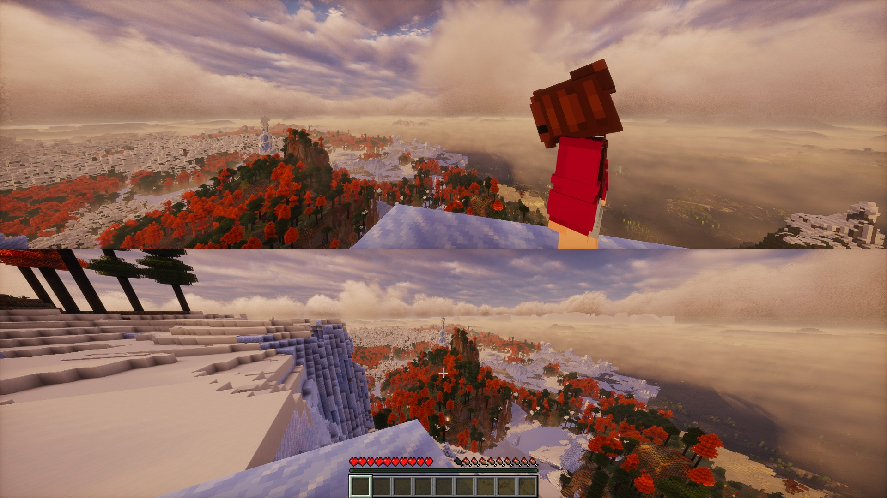

# Couch Co-op



Local splitscreen for Minecraft Java **26.3** on **Fabric**, **Forge** and **NeoForge**, built around PlayStation 5 (DualSense) controllers, with Xbox One/Series pads supported too. Guests get saved profiles with their own names and skins.

## How it works

Each player gets their own game window. The mod tiles the windows across the whole primary monitor, like one fullscreen game, and gives each window its own controller. Guest windows join the host's world over LAN. This is the same approach console-style splitscreen mods take on Java Edition, which has no built-in support for several local players.

- **Controllers** are read through SDL3, which Minecraft 26.x already ships. SDL recognises DualSense and Xbox pads natively, and reads them even when a window is not focused. On DualSense pads the player-number LEDs and light bar show which player you are.
- **Windows** coordinate through lock files in your temp folder (`%TEMP%\couchcoop`), one session per game folder, so separate launcher instances running at the same time are never tiled together.
- **The mouse** belongs to the keyboard player. Windows driven by a controller never capture the cursor.

## Playing

1. Install the jar for your loader in `mods/` (`couchcoop-fabric-…`, `couchcoop-forge-…` or `couchcoop-neoforge-…`) and start Minecraft normally. No other mods are needed.
2. Optional: press **Cross** to play player 1 on a controller. Otherwise keyboard and mouse work as usual.
3. Load a world.
4. To add a player, **hold Options for one second** on a free controller. A *Who's playing?* list appears, driven only by that controller:
   - pick a saved **profile**,
   - **+ New profile** to create one (type the name on the keyboard), or
   - **Play as guest** for a temporary `Player2`-style name.

   A new window opens for that player and joins your world. Both windows resize to split the screen. Up to 4 players are supported.
5. A guest leaves by choosing *Disconnect* from the pause menu, and its window closes. When the session drops back to one window, the host window gets its original size, border and taskbar back.

Singleplayer worlds are opened to LAN automatically, with authentication off, so that offline guest profiles can connect.

## Guest profiles and skins

Profiles are saved in `config/couchcoop/profiles.json`. A profile's name is its offline account name, so each profile keeps its own inventory, position and stats in every world.

- In the *Who's playing?* list, press **Triangle** on a profile to edit or delete it. The list puts the profile a controller last played first.
- **Skin**: enter a real Minecraft username to use that account's skin, or a path to a 64×64 PNG (relative paths are looked up in `config/couchcoop/skins/`). Username skins are cached, so they keep working offline. Every window on the PC shows guest skins; players on other computers see default skins.
- A profile can also override `lookSensitivity`, `invertLookY` and any `bind.*` button in the JSON file, for example `"bindings": { "jump": "R1" }`.

Player 1 always plays as the account signed in to the launcher.

## Controls

Defaults follow Minecraft's console layout on PlayStation. Xbox pads use the button in the same position (Cross = A, Circle = B, Square = X, Triangle = Y, L1/R1 = LB/RB, L2/R2 = LT/RT, Create = View, Options = Menu).

| In game | Default | In menus | Default |
|---|---|---|---|
| Move / look | Left / right stick | Move cursor | Left stick |
| Jump | Cross | Click | Cross |
| Sneak | R3 (press the right stick) | Back / close | Circle or Options |
| Swap hands | Square ¹ | Shift-click (move stack across) | Triangle |
| Inventory | Triangle | Right-click (split stack) | Square |
| Attack / mine | R2 | Scroll | Right stick |
| Use / place | L2 | Jump between slots, buttons and the recipe book | D-pad |
| Hotbar left / right | L1 / R1 | | |
| Sprint | L3 | | |
| Change camera | D-pad up | | |
| Drop item | D-pad down | | |
| Pick block | D-pad left ² | | |
| Chat | D-pad right | | |
| Player list | Touchpad | | |
| Screenshot | Create | | |
| Pause | Options | | |

¹ Consoles open crafting here; Java's inventory already contains the crafting grid.
² Consoles emote here; Java has no emotes.

Circle (in game), the PS button and the mute button are free and can be bound. All bindings (PlayStation or Xbox names), look sensitivity, deadzone, Y inversion, layout (`TOP_BOTTOM` or `SIDE_BY_SIDE`), `coverTaskbar`, `splitFrameLimit` (FPS cap per window while split, default 60), `guestMemoryMb` (memory per guest window, default 3072), guest audio, `rumble`, `rumbleStrength` and `adaptiveTriggers` are in `config/couchcoop.properties`.

### On-screen keyboard

A keyboard appears when you type: straight away in chat, on signs, in books and in the profile form, and elsewhere (anvils, search boxes such as the recipe book's) once you click the text box or move onto it with the D-pad. Move between keys with the D-pad or left stick.

| Button | Does |
|---|---|
| Cross | Type the highlighted key |
| Square / Triangle | Delete / space |
| L1 / R1 | Shift / symbols |
| L2 / R2 | Move the text cursor |
| R3 or the Tab key | Tab: completes commands and player names in chat |
| Options | Enter (send chat, confirm) |
| Circle | Hide the keyboard (press Cross on the text box to bring it back) |

### Rumble and adaptive triggers

Controllers rumble when you take damage (harder for bigger hits) and tick when you break a block. On a DualSense, L2 tightens as you draw a bow, crossbow or trident. Xbox pads get a light trigger buzz while drawing instead.

## Limitations

- **Launcher compatibility for auto-launch:** the mod restarts the game using the current process's own command line. That works with the official launcher, Modrinth App, CurseForge and ATLauncher. **Prism Launcher and MultiMC** hide the command line. Fabric still works there through a fallback, but on Forge and NeoForge under Prism you must start the extra windows yourself. Windows started by hand join the session and get tiled anyway; give each one a controller by pressing Cross.
- **Multiplayer servers:** guests use offline profiles, so joining a remote server only works if that server runs in offline mode. Singleplayer/LAN worlds always work.
- **Performance:** every player runs a full copy of the game, so 3–4 players needs plenty of RAM and a decent GPU. Guest windows are capped at `guestMemoryMb` (3 GB by default) rather than copying window 1's memory setting.
- **Playing from another computer:** stream the desktop with Sunshine and Moonlight (or Parsec). Controllers plugged into the other computer arrive as virtual controllers and work like local ones. Steam Remote Play is harder: it may only stream one game window.
- **One keyboard and mouse:** one player can use keyboard and mouse (window 1) while the others use controllers. Controller windows then ignore the mouse and can't take the keyboard, so a stray click doesn't pull the keyboard player out of their window.
- **Controlify** reads controllers too, so Fabric and NeoForge refuse to start with both installed (Forge doesn't check, but the two would fight over controllers). pcal's *Splitscreen Support* also moves windows around and is flagged as a conflict.

## Credits

- Build setup follows the official templates: [Fabric Example Mod](https://github.com/FabricMC/fabric-example-mod), the [Forge MDK](https://files.minecraftforge.net/) and [MDKExamples](https://github.com/MinecraftForge/MDKExamples), and jaredlll08's [MultiLoader-Template](https://github.com/jaredlll08/MultiLoader-Template).
- The Gradle wrapper (`gradlew`, `gradlew.bat`, `gradle/wrapper/`) is part of [Gradle](https://gradle.org/), licensed under Apache 2.0.
- The one-window-per-player approach is shared with earlier Java splitscreen mods such as [Hot-Join](https://modrinth.com/mod/hotjoin). Controller support was written from scratch but was inspired by [Controlify](https://github.com/isXander/Controlify).
- Default controls follow Minecraft's console layout as documented on the [Minecraft Wiki](https://minecraft.wiki/w/Controls).
- At runtime the mod uses libraries that ship with Minecraft or the mod loader: [SDL3](https://www.libsdl.org/) through [LWJGL](https://www.lwjgl.org/), [Mixin](https://github.com/SpongePowered/Mixin) and [Gson](https://github.com/google/gson). None are bundled in the jars.

Couch Co-op is not an official Minecraft product and is not approved by or associated with Mojang or Microsoft.

## Building

Requires JDK 25.

```
./gradlew build
```

Jars are written to `fabric/build/libs/`, `forge/build/libs/` and `neoforge/build/libs/`. `./gradlew :fabric:runClient`, `./gradlew :forge:runClient` and `./gradlew :neoforge:runClient` start dev clients; running the same one twice shows the window tiling. Add `-PsmokeTest` to the Fabric one to have it quit by itself ten seconds after loading.

## Project layout

```
common/   shared code and mixins, compiled into all three jars (26.x is unobfuscated, so names match).
          Its own Gradle project only gives IDEs a classpath; its jar is not shipped.
fabric/   Fabric entry point and fabric.mod.json
forge/    Forge entry point and mods.toml
neoforge/ NeoForge entry point and neoforge.mods.toml
```
